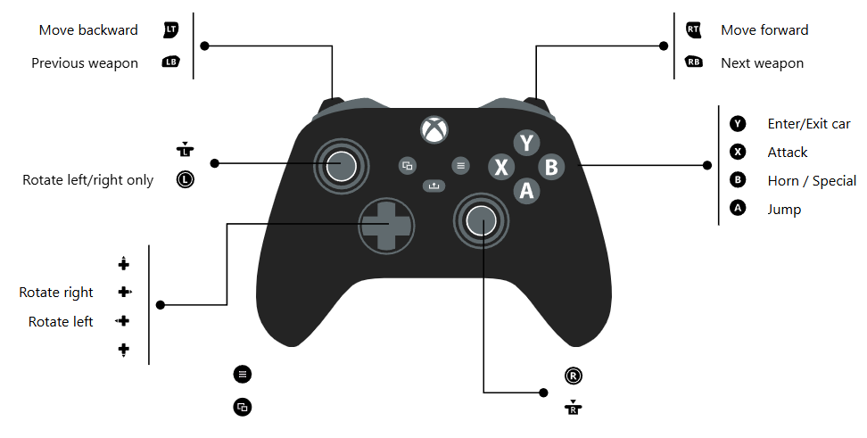

# GInput for GTA2
This plugin makes any XInput compatible device work properly on GTA2.
Originally targets GTA2 9.6.0.0. The maintainer has also confirmed the locally built
`GInputII.asi` working with GTA2 v11.44 using the Plugin-SDK changes described below.

## GTA2 v11.44 compatibility

The v11.44 compatibility changes are in Plugin-SDK, which is statically linked
into the ASI. They were originally local SDK edits, rather than a change to this
plugin's source. They are preserved in
[`patches/plugin-sdk-gta2-compatibility.patch`](patches/plugin-sdk-gta2-compatibility.patch).

- `shared/GameVersion.cpp` lets other GTA2 executables, including v11.44, use the
  SDK's existing 9.6 version identifier so version-gated hooks are installed.
- `shared/DynAddress.cpp` keeps GTA2's fixed virtual addresses and corrects external
  DLL address calculation. This avoids shifting addresses `0x10000` too low with
  v11.44's different executable image base.
- `plugin_II/game_II/CCarManager.h` preserves an additional local SDK structure
  correction from the build environment: the car pool contains objects rather
  than pointers. This is separate from the v11.44 address changes.

The build still defines `PLUGIN_SGV_96EN` because it reuses the 9.6 address set;
there is no separate v11.44 address table. The version fallback accepts other
GTA2 executables too, but compatibility with versions other than 9.6 and the tested
v11.44 executable has not been established.

## Building with v11.44 compatibility

Use Visual Studio 2022 with C++ desktop development tools. The local build used
[Plugin-SDK](https://github.com/DK22Pac/plugin-sdk) at commit
`5da18b6f1956bb20bdfa39dcb07c44863ce26c81` plus the included patch.

1. Prepare a Plugin-SDK checkout at that commit and set `PLUGIN_SDK_DIR` to its
   absolute path. Set `GTA_II_DIR` to the game directory; the plugin's post-build
   step copies the ASI into its `scripts` folder, which must exist.
2. Apply the patch to a clean SDK checkout. From this repository's root in
   PowerShell, run:

   ```powershell
   git -C "$env:PLUGIN_SDK_DIR" apply --check "$PWD/patches/plugin-sdk-gta2-compatibility.patch"
   git -C "$env:PLUGIN_SDK_DIR" apply "$PWD/patches/plugin-sdk-gta2-compatibility.patch"
   ```

3. Rebuild the SDK's `plugin_II/Plugin_II.vcxproj` using `Release | Win32` to
   produce `output/lib/Plugin_II.lib`. Rebuilding the SDK is necessary; changing
   its source alone does not update an existing library or ASI.
4. Run `premake5.bat` here, open `project_files/gta2-ginput.sln`, and build
   `ReleaseII | Win32`. The result is `output/asi/GInputII.asi`.

An unpatched SDK build does not include these v11.44 compatibility changes.

## Distributing a build

Package `GInputII.asi` with `resources/GInputII.ini`. Players need an ASI loader;
the patched SDK library is linked into the ASI and does not need to be installed
separately. Identify v11.44-tested builds and include their source revision and
SDK patch information with the download.

Build outputs and `*.asi` files are currently ignored by Git. Uploading a binary
as a release asset does not require changing `.gitignore`; committing it into
the repository requires an explicit exception or force-add.

## List of controls:

Added layout.
`ControlSetP1 = 5`



Original mod layouts: 

### A/1:
- Previous Weapon: L2
- Next Weapon: L1
- Special: Circle
- Brake/Jump: R1
- Turn Left/Right: DPadLeft DPadRight
- Forward: Cross
- Backward: Square
- Attack/Fire: R2
- Enter/Exit Car: Triangle

### B/2:
- Previous Weapon: L2
- Next Weapon: L1
- Special: R2
- Brake/Jump: R1
- Turn Left/Right: DPadLeft DPadRight
- Forward: Cross
- Backward: Triangle
- Attack/Fire: Circle
- Enter/Exit Car: Square

### C/3:
- Previous Weapon: L2
- Next Weapon: L1
- Special: Square
- Brake/Jump: Circle
- Turn Left/Right: DPadLeft DPadRight
- Forward: Triangle
- Backward: Cross
- Attack/Fire: R1
- Enter/Exit Car: R2

### D/4:
- Previous Weapon: R2
- Next Weapon: R1
- Special: Square
- Brake/Jump: Circle
- Turn Left/Right: DPadLeft DPadRight
- Forward: L1
- Backward: L2
- Attack/Fire: Triangle
- Enter/Exit Car: Cross

### Valid for any control set:
- Pause/Resume: Start
- Exit Game: (In Pause) Select
- Next Message: Select
